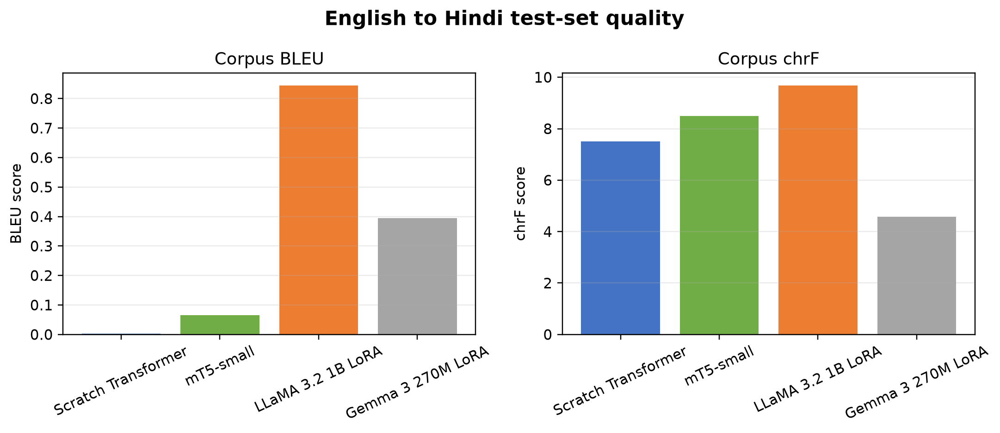
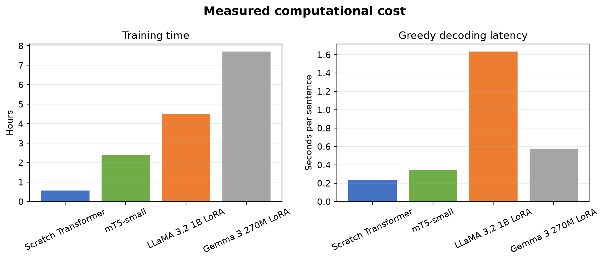

# English to Hindi Machine Translation Systems Comparison

This project compares four neural machine translation approaches on one fixed English-to-Hindi dataset: a Transformer encoder-decoder trained from scratch, full fine-tuning of mT5-small, and LoRA adaptation of LLaMA 3.2 1B and Gemma 3 270M. The objective is to measure translation quality and computational cost under a reproducible protocol, then explain how architecture, pretraining, tokenization, and adaptation affect the results.

The main result is that **LLaMA 3.2 1B with LoRA is the strongest of the four systems**, with corpus BLEU 0.845 and chrF 9.680. Absolute scores are low for every model, so none should be treated as production-ready. The experiment is most useful as a controlled comparison of limited-data adaptation strategies.

## Dataset

The experiment uses the public [IIT Bombay English-Hindi Parallel Corpus](https://www.cfilt.iitb.ac.in/iitb_parallel/). The official corpus is sampled without normalization, deduplication, length filtering, or language detection.

| Split | Sentence pairs | Selection |
|---|---:|---|
| Train | 30,000 | Reservoir sample from the official training split |
| Validation | 520 | Complete official development split |
| Test | 2,507 | Complete official test split |

The training sample uses seed `1729`. `data/iitb_en_hi_30k/manifest.json` and `train_indices.txt` record the exact selection and checksums. All four systems use the same saved splits.

## Models and adaptation

| System | Architecture and tokenizer | Adaptation | Trainable parameters |
|---|---|---|---:|
| Scratch Transformer | 4-layer encoder and 4-layer decoder, 256 hidden units, 4 heads; 8,000-token SentencePiece BPE trained only on the selected training split | Full training from random initialization | 11.51M |
| mT5-small | Multilingual encoder-decoder with pretrained SentencePiece vocabulary | Full fine-tuning | 300.18M |
| LLaMA 3.2 1B | Pretrained decoder-only causal LM with its native tokenizer | LoRA rank 8 on all linear layers | 5.64M of 1.24B |
| Gemma 3 270M | Instruction-tuned decoder-only causal LM with its native tokenizer | LoRA rank 8 on all linear layers | 1.90M of 270.00M |

The causal models receive the prompt `Translate the following English sentence into Hindi.` followed by the source sentence. Prompt and padding tokens are masked in the training labels. The LLaMA and Gemma weights were downloaded from the Unsloth mirrors of the original model families so the gated upstream repositories were not required; the run configuration records the exact model identifiers.

## Evaluation protocol

- Corpus BLEU and chrF are calculated with SacreBLEU on the complete 2,507-sentence test set.
- Every result uses greedy decoding with beam size 1; no sampling is used.
- Training time, test inference time, seconds per sentence, peak allocated GPU memory, total parameters, and trainable parameters are logged.
- Step-level and epoch-level JSONL logs, run configuration, checkpoints, status, summary metrics, and sentence-level predictions are retained under `outputs/runs/<run_id>/`.
- Training used PyTorch 2.11.0 with CUDA 12.8 on an NVIDIA GeForce RTX 5060 Laptop GPU with 8 GB VRAM.

## Results

| Model | BLEU | chrF | Train time | Test inference | Seconds per sentence | Total / trainable params | Peak GPU |
|---|---:|---:|---:|---:|---:|---:|---:|
| Scratch Transformer | 0.003 | 7.509 | 0.57 h | 592.4 s | 0.236 | 11.51M / 11.51M | 1.38 GiB |
| mT5-small | 0.065 | 8.487 | 2.39 h | 863.0 s | 0.344 | 300.18M / 300.18M | 5.95 GiB |
| LLaMA 3.2 1B LoRA | **0.845** | **9.680** | 4.50 h | 4097.1 s | 1.634 | 1.24B / 5.64M | 2.84 GiB |
| Gemma 3 270M LoRA | 0.394 | 4.575 | 7.71 h | 1431.7 s | 0.571 | 270.00M / 1.90M | 1.38 GiB |





The scratch model trained and decoded fastest, but its output commonly collapsed into a repeated unrelated phrase. Full mT5 fine-tuning improved chrF modestly but also showed severe repetition. LLaMA produced the best short translation and the best aggregate scores, while still hallucinating unrelated interface-like questions on many longer inputs. Gemma was parameter-efficient but often repeated unrelated religious-style text or returned an empty string. The sentence-level examples in [qualitative_samples.md](results/qualitative_samples.md) make these failure modes auditable.

The large gap between low BLEU and somewhat higher chrF indicates partial character-level overlap without reliable word-sequence fidelity. LLaMA's stronger result is consistent with its larger pretrained capacity, but its 1.63 seconds per sentence makes it the slowest system at greedy inference. Gemma's long training time despite its smaller size shows that parameter count alone does not determine wall-clock efficiency; architecture, sequence processing, checkpointing, and implementation kernels also matter.

## Responsible and ethical AI analysis

The systems can hallucinate fluent but unsupported Hindi, omit entities, reverse or weaken meaning, and introduce unrelated religious or user-interface language. These errors are especially serious for news, government, finance, health, legal, and violence-related text. The qualitative samples include sensitive material where a model output is unrelated or empty, demonstrating that automatic scores alone are insufficient.

The corpus may contain topical, regional, gender, political, and religious imbalances inherited from its sources. A model can reproduce those patterns or attach culturally loaded language to neutral inputs. Transliteration choices and formal Hindi references can also disadvantage readers who expect different dialects or mixed Hindi-English usage.

Recommended safeguards are human review for consequential translations, explicit uncertainty or abstention when quality is low, terminology tests for named entities and numbers, stratified evaluation across domains and demographic references, toxicity and stereotype audits by fluent Hindi reviewers, source/reference retention for traceability, and monitoring for empty, repetitive, or excessively long outputs. These models should not be deployed for high-stakes translation on the evidence in this experiment.

## Temperature experiments

Temperature experiments were intentionally deferred. All reported outputs use deterministic greedy decoding, so temperature is not active in the comparison. A future sampling study should hold the test subset and maximum generation length fixed, repeat each nonzero temperature with multiple seeds, and report quality plus hallucination, repetition, and variance. This omission is stated explicitly rather than mixing unrun results into the analysis.

## Reproduce the project

Create and activate a virtual environment, then install the dependencies. A CUDA-enabled PyTorch build compatible with the local driver is required for the recorded GPU configuration.

```powershell
python -m venv .venv
.\.venv\Scripts\Activate.ps1
pip install -r requirements.txt
```

Place the official IIT Bombay corpus files in the expected source location, then create the fixed subset:

```powershell
python scripts\prepare_iitb_subset.py
```

Run the systems from the repository root:

```powershell
python src\train_transformer.py --run-id transformer_reproduction
python src\train_mt5.py --run-id mt5_reproduction
python src\train_causal_lora.py --model llama --model-id unsloth/Llama-3.2-1B --model-path models\llama-3.2-1b --run-id llama_reproduction
python src\train_causal_lora.py --model gemma --model-id unsloth/gemma-3-270m-it --model-path models\gemma-3-270m-it --run-id gemma_reproduction
```

The exact report assets can be regenerated after the named runs are available:

```powershell
python scripts\generate_report_assets.py
```

During a run, monitor the latest status and epoch records with:

```powershell
Get-Content outputs\queue_status.json
Get-Content outputs\runs\<run_id>\epochs.jsonl -Wait
```

## Repository structure

```text
data/                 Fixed local train, validation, and test splits
models/               Local pretrained model snapshots
outputs/runs/         Full logs, checkpoints, summaries, and predictions
results/              Tracked comparison tables, plots, and qualitative samples
scripts/              Dataset, queue, pause, and report-asset utilities
src/                  Training and evaluation implementations
report/               Assignment report in Word format
output/pdf/           Submission-ready PDF report
```

Large datasets, pretrained weights, checkpoints, and raw run outputs are intentionally excluded from Git. The tracked `results/` files contain the report-grade aggregate metrics, epoch history, figures, and selected sentence-level outputs.

## Conclusion

LLaMA 3.2 1B LoRA is the best model in this experiment because it leads both automatic quality metrics and produces the most plausible short translations while updating only 0.454% of its parameters. That advantage comes with the highest inference latency and does not overcome the experiment's low absolute quality. More data, stronger sequence-level tuning, length and repetition controls, domain-balanced evaluation, and human review are required before practical use.

## References

- Vaswani et al., [Attention Is All You Need](https://arxiv.org/abs/1706.03762), 2017.
- Kunchukuttan et al., [The IIT Bombay English-Hindi Parallel Corpus](https://aclanthology.org/L18-1548/), 2018.
- Xue et al., [mT5 A Massively Multilingual Pre-trained Text-to-Text Transformer](https://arxiv.org/abs/2010.11934), 2021.
- Meta, [Llama 3.2 1B model card](https://huggingface.co/meta-llama/Llama-3.2-1B).
- Google, [Gemma 3 model overview](https://ai.google.dev/gemma/docs/core/model_card_3).
